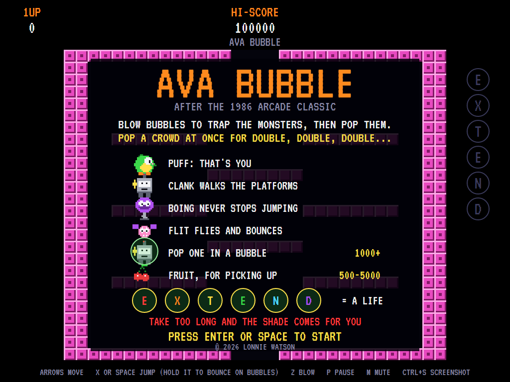
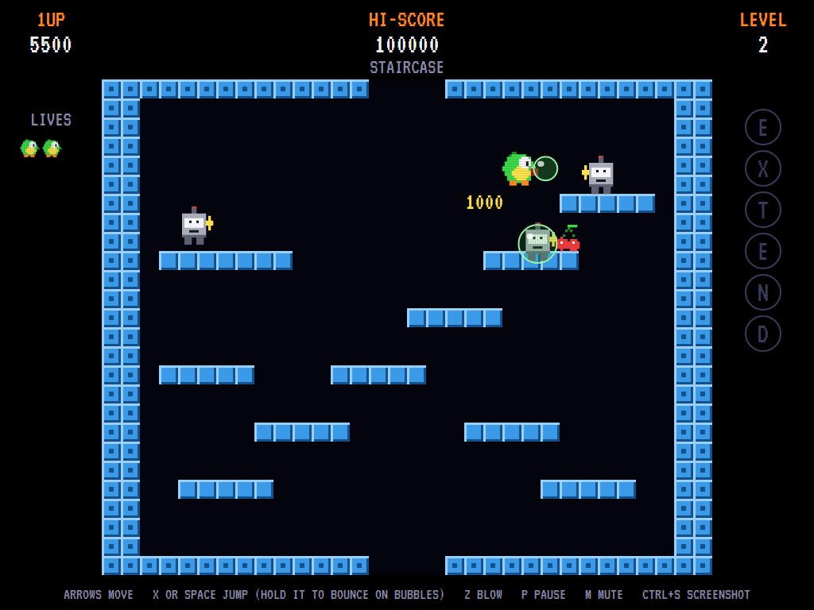
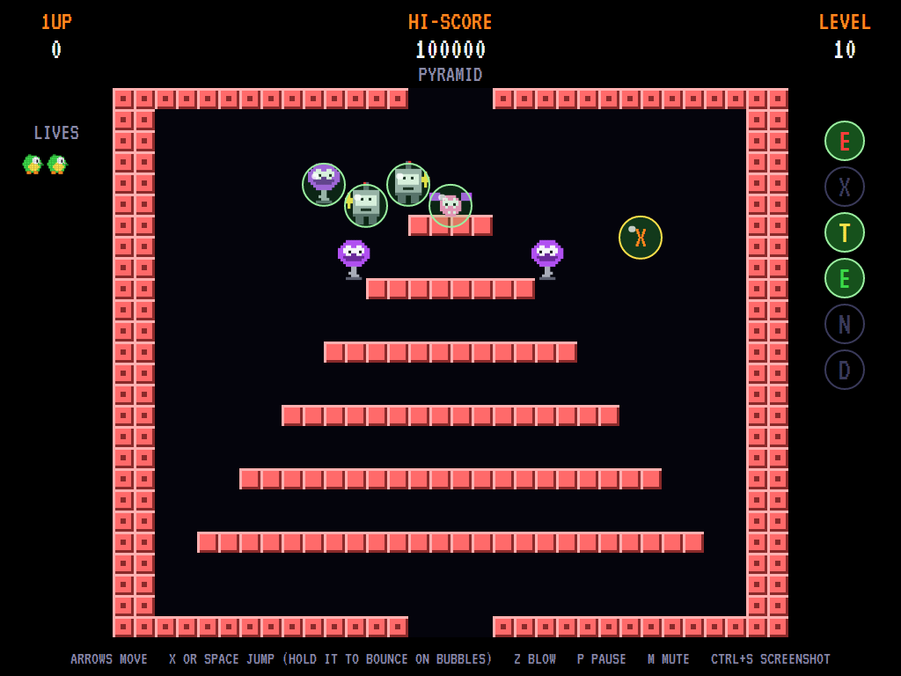
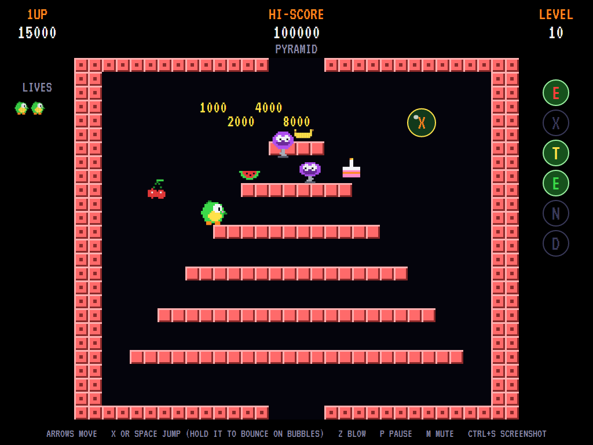
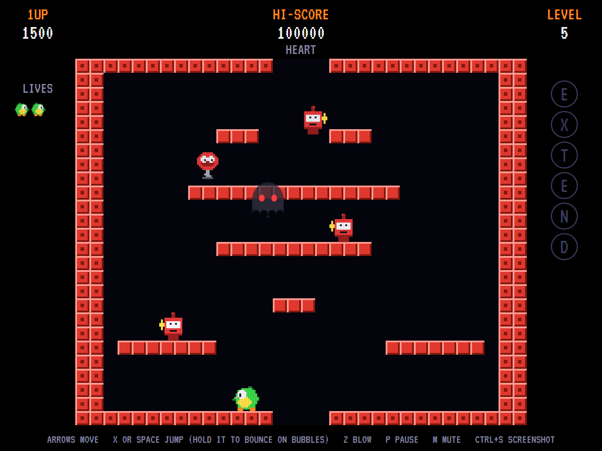
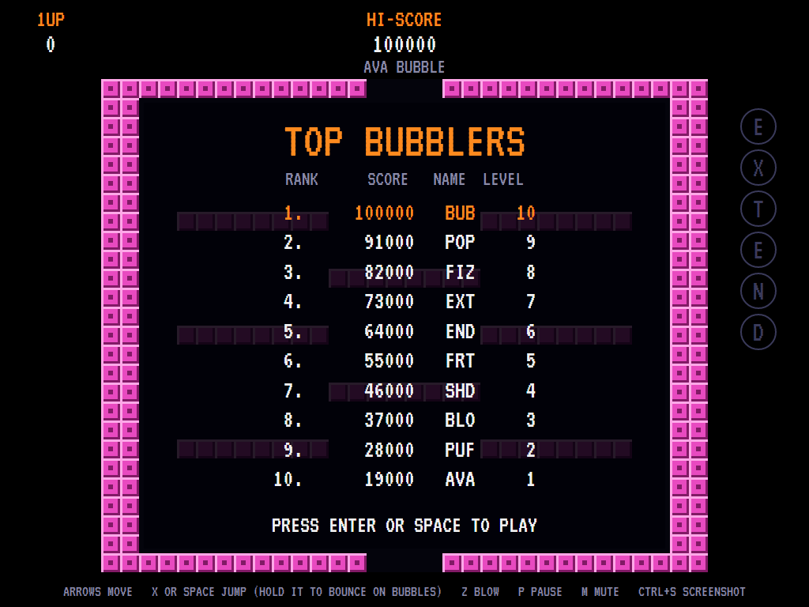

# AVABubble

[](https://github.com/Harlock123/AVABubble/actions/workflows/build.yml)

A bubble-blowing platform game in the style of Taito's 1986 arcade game **Bubble Bobble**, built with
.NET 10 and Avalonia UI. You're Puff, a round little creature who blows bubbles: trap the monsters in
them, then pop them, and they turn into fruit. Pop a crowd at once for double, double, double the
points. Clear every monster to move on through twelve levels. Puff, the monsters and the levels are
all this game's own.

## Features

- **Blowing and popping**: a bubble shoots from Puff's mouth and traps the first monster it meets,
  then floats up and along the top on the air currents. Touch a bubble to pop it; every bubble
  touching it pops too. Each trapped monster in one go is worth double the one before: 1,000, 2,000,
  4,000, 8,000 and on. Each comes out as a piece of fruit to pick up (500 to 5,000).
- **Bouncing**: hold jump as you come down on a bubble and you bounce off it instead of popping it.
  That's the way up to high places.
- **Platforms** you jump up through from below and land on from above, walls that block, and a gap
  in the floor that drops you back in at the top.
- **The monsters**: **Clank**, a wind-up robot, walks the platforms and hops up after you. **Boing**
  never stops jumping. **Flit**, a little bat, flies about bouncing off everything. A monster left in
  its bubble too long gets out angry (red, and faster).
- **Hurry up**: take more than 30 seconds over a level and every monster gets angry; at 40 seconds
  **the Shade** comes for you, through walls, and it can't be stopped.
- **EXTEND**: letter bubbles float up out of the gap in the floor now and then. Collect E, X, T, E, N
  and D for an extra life and a skip to the next level.
- **Twelve levels**: *First Bubbles, Staircase, Columns, Boxes, Heart, Zigzag, Shelves, Open Sky,
  A.V.A., Pyramid, Tunnels* and *Fortress*, each in its own colours. Then round again, faster.
- **Sound**: a bouncy original level tune, the blow, the trap, the pops, the fruit, the hurry-up and
  the Shade, and fanfares, all mixed by OpenAL.
- **Attract mode**: leave the title alone for 15 seconds and a computer player plays a demonstration.
  It hunts the monsters, climbing by jumping up through the platforms and dropping off the edges. It
  blows from a safe distance, pops what it's caught, collects fruit and letters, steps out from under
  falling monsters and keeps clear of the Shade. It clears most of the levels.
- **Three lives**, extras at 30,000 and every 70,000 after, and a **top-ten high-score table** with
  arcade-style initials entry. The table records the level you reached.
- **Any window size**: the screen scales to fit, letterboxed. **Ctrl+S** saves a screenshot.
- **One self-contained executable** per platform: Windows, macOS and Linux on Intel/AMD and ARM.

## Screenshots

| Title screen | A level under way | A crowd in bubbles |
|:------------:|:-----------------:|:------------------:|
|  |  |  |
| Who's who. | *Staircase*: a robot caught, a bubble on its way. | *Pyramid*: four caught, and a letter X floating by. |

| Popped all at once | The Shade | The high-score table |
|:------------------:|:---------:|:--------------------:|
|  |  |  |
| 1,000, 2,000, 4,000, 8,000, and the fruit. | Too long on *Heart*: everything's angry, and the Shade's coming. | The best bubblers. |

The screenshots are made by the tests, which play the game in a real (headless) window; see
[Tests](#tests).

## Download and run

Ready-to-run builds for Windows, macOS and Linux, on both Intel/AMD and ARM, are on the
[Releases page](https://github.com/Harlock123/AVABubble/releases/tag/latest). **Latest build** is
rebuilt on every push to `main`. Each download is one self-contained executable: no .NET install is
needed.

| Platform | Archive |
|---|---|
| Windows | `AVABubble-win-x64.zip`, `AVABubble-win-x86.zip`, `AVABubble-win-arm64.zip` |
| macOS | `AVABubble-osx-arm64.tar.gz` (Apple silicon), `AVABubble-osx-x64.tar.gz` (Intel) |
| Linux | `AVABubble-linux-x64.tar.gz`, `AVABubble-linux-arm64.tar.gz`, `AVABubble-linux-arm.tar.gz` |

```bash
tar -xzf AVABubble-linux-x64.tar.gz     # or linux-arm64, linux-arm, osx-arm64, osx-x64
./AVABubble
```

On Windows, unzip and run `AVABubble.exe`. On macOS, if Gatekeeper refuses to open it, run
`xattr -d com.apple.quarantine AVABubble` once. Run with `--no-audio` for silence.

**Sound** comes through OpenAL Soft, built in for every platform. In a virtual machine the game
detects it and uses a larger audio buffer, so the sound doesn't break up.

**Gamepads** use SDL2, which is bundled for Windows, macOS and Intel/AMD Linux. ARM Linux builds need it
installed; without it the keyboard still works:

```bash
sudo apt install libsdl2-dev            # Debian / Ubuntu / Raspberry Pi OS
sudo pacman -S --needed sdl2-compat     # Arch / Omarchy
```

## Controls

| Input | Action |
|-------|--------|
| **Arrow keys** / **A**, **D** | Walk |
| **X** / **Space** / **Up** | Jump (hold it to bounce on bubbles) |
| **Z** / **Ctrl** | Blow a bubble |
| **Enter** / **Space** | Start a game |
| **P** / **Esc** | Pause (Esc again to quit) |
| **M** | Mute |
| **Ctrl+S** / **Cmd+S** | Save a screenshot to the Pictures folder |

**Gamepad**: left stick or D-pad to walk, **A** to jump, **B** or **X** to blow; **Start** or **A**
starts, **Start** pauses, **Back** (while paused) quits.

**Entering initials**: type letters, or dial with **Up**/**Down** and accept with **Space**; **Left** /
**Backspace** go back; **Enter** finishes.

## Scoring

| What | Points |
|---|---:|
| A monster popped | 1,000, doubling for each more in the same pop |
| Fruit: cherry, banana, melon, cake, diamond | 500, 700, 1,000, 2,000, 5,000 |
| An empty bubble popped | 10 |
| E X T E N D | an extra life |

## Tests

```bash
dotnet test AVABubble.slnx
```

The engine has no UI and runs in fixed 60 Hz steps, so it plays the same at any frame rate, and a seed
always plays the same game. The tests check:

- the levels; walking, jumping up through platforms and landing on them, walking off the edge;
- walls, and dropping through the floor's gap to the top;
- trapping a monster, popping it for points and fruit, and picking up the fruit; chain pops doubling;
- bouncing on bubbles; a monster getting out angry; being caught;
- flyers bouncing about; hurry-up and the Shade; EXTEND; letter bubbles floating up;
- clearing a level, extra lives, the title tune, the demonstration's sound, pausing, and every sound
  and sprite.

A computer player (the attract-mode one) plays whole games in them and must clear the first level.

The screenshot tests draw the real screen in a headless window. To refresh the README's pictures:

```bash
BUBBLE_SHOTS=$PWD/Images dotnet test tests/AVABubble.Tests --filter ScreenshotTests
```

## Building

```bash
dotnet build AVABubble.slnx
dotnet run --project src/AVABubble
```

Needs the .NET 10 SDK. The sounds are made by `tools/make_sounds.py` (standard-library Python):
`python3 tools/make_sounds.py` rewrites `src/AVABubble/Sounds`.

## Project structure

```
AVABubble/
├── AVABubble.slnx
├── src/AVABubble/
│   ├── Engine/
│   │   ├── GameEngine.cs        # States, scoring, extra lives and the music
│   │   ├── GameEngine.Play.cs   # Walking, jumping and falling, bubbles and popping, the monsters,
│   │   │                        # fruit, EXTEND, the hurry-up and the Shade, and the levels
│   │   ├── Entities.cs          # The hero, monsters, bubbles, fruit and the Shade
│   │   ├── AttractPilot.cs      # The computer player for the demonstration (and the tests)
│   │   ├── HighScoreTable.cs, InitialsEntry.cs
│   │   ├── InputHandler.cs, ControllerManager.cs  # Keys and an SDL2 gamepad
│   │   └── SoundManager.cs      # Effects, the level music and the tunes through OpenAL
│   ├── Audio/                   # The OpenAL engine (from the author's AVABand)
│   ├── Models/                  # The field, the twelve levels, and the pixel art
│   ├── Views/                   # The screen: the level, Puff and the monsters, bubbles, panels,
│   │                            # title and tables
│   └── Sounds/                  # The synthesised effects and tunes
├── tests/AVABubble.Tests/       # Gameplay and screenshot tests
├── tools/make_sounds.py
└── Images/                      # Screenshots
```

## About and licence

AVABubble © 2026 Lonnie Watson, under the [MIT License](LICENSE).

*Bubble Bobble* © 1986 Taito; the name and its characters belong to their current owner. AVABubble is
an independent, unofficial game in its style. Its characters, levels, graphics, sounds, tunes and
code are its own; nothing is taken from the arcade machine's program, levels, graphics or sound. It is
not affiliated with or endorsed by any rights holder.

Bundled components keep their own licences: the VT323 font (SIL Open Font License 1.1, by Peter Hull;
`src/AVABubble/Assets/Fonts/VT323-OFL.txt`), OpenAL Soft (LGPL-2.0-or-later; loaded as a separate
library; `src/AVABubble/Audio/native/COPYING-openal-soft.txt`), and the MIT-licensed Avalonia,
Silk.NET, NVorbis, NLayer and SDL2-CS (with SDL2 under the zlib licence).
